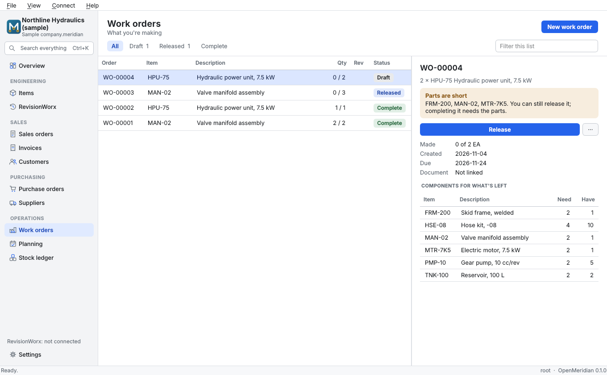
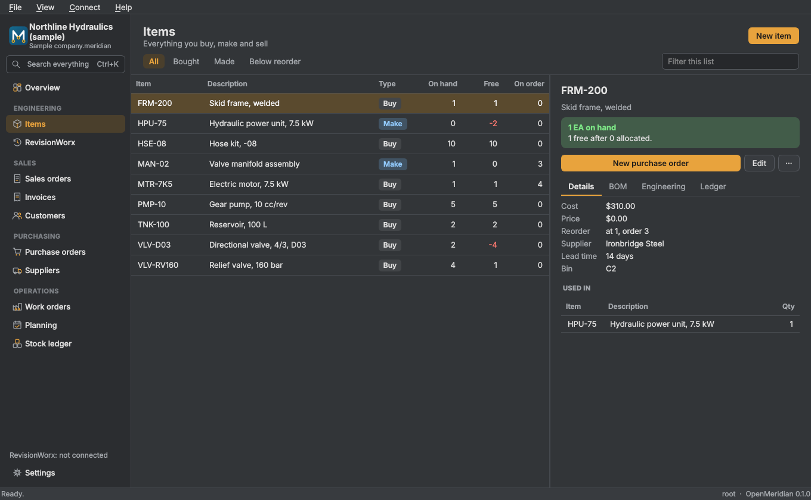

# OpenMeridian

<p align="center">
  
</p>

**Free and open-source lightweight ERP for small engineering businesses.** Items, bills of materials, stock, sales,
invoices, purchasing, work orders and planning in one file on your computer, connected to the controlled documents in
[RevisionWorx](https://github.com/nrobertson152/RevisionWorx). Windows and Linux. Version 0.1.0.

Copyright © 2026 Nate Robertson.
Licensed under the GNU General Public License v3.0 or later (see `LICENSE`).

OpenMeridian works fully offline and has no accounts, telemetry, advertisements or feature limits. If you find it useful
you can optionally [support development on Ko-fi](https://ko-fi.com/nr270343).



## What it does

- **Items and BOMs.** Bought and made items, multi-level BOMs with a rolled-up cost, and refused cycles.
- **Stock you can trust.** Every movement is a permanent ledger entry. On-hand is always the sum of the ledger, and
  corrections are new entries with a reason. Costs are moving averages.
- **Sales to cash.** Sales orders, partial shipments, invoices for what actually shipped, tax kept with the invoice,
  PDFs and CSV exports.
- **Purchasing.** Purchase orders, partial receipts, what's late.
- **Production.** Work orders that reserve parts, consume them on completion and show what's short.
- **Lots.** A part bought or made in lots says which lot at every step: received as the supplier's lot, used on a work
  order, made as a lot of its own, shipped. **Trace** follows a lot to the lots and units made from it and the
  customers they were shipped to, and back to where it came from, for a recall. Lots to use are filled in oldest first,
  for you to check: what's recorded is what you say went.
- **Planning.** What to buy and make to cover demand and reorder points, through every BOM level. You review the
  suggestions, and they become draft orders.
- **Find anything.** Ctrl+K searches every record. Every list has filters and a panel for what you've selected, with
  one clear next step.



Try it without entering anything: choose **Explore a sample company** on the start page.

## With RevisionWorx

Point a company at a RevisionWorx workspace in **Settings**. RevisionWorx stays the record for engineering, and
OpenMeridian reads it through RevisionWorx's own command line. The one thing it writes there is the units its own work
orders build (below).

- **Link items** to their controlled documents and see what's released.
- **Import a BOM from a released revision**, read by RevisionWorx's own BOM reader. Stock, costs and prices stay as they
  are. A revision that isn't released is refused unless you choose to import it anyway.
- **Work orders record the revision they build**, at the moment they're released.
- **Out of step:** when engineering releases a new revision, the Overview, the sidebar and the item say which BOMs and
  work orders were made from an older one. Nothing changes until someone imports the new one.
- **Open engineering changes** are shown beside the documents.
- **Units built go into RevisionWorx's unit register.** An item can be made with serial numbers: completing its work
  order asks for the serial of each unit, and registers them in RevisionWorx as built, as that item, to the revision the
  work order was released to. A retry never registers anything twice. Anything RevisionWorx refuses (a serial it already
  has for another unit, say) stays on the work order as not registered, with RevisionWorx's reason, until it's sorted
  and registered again. From then on the unit's history is RevisionWorx's, and FieldWorx finds it by its serial plate.

## What it doesn't do

OpenMeridian is deliberately small, and a simple result mustn't look like an exact one.

- **It isn't an accounting system.** No general ledger, payments in part, credit notes, multi-currency or tax returns,
  and one tax rate. Have your accountant check anything you rely on.
- **Planning is not scheduling.** It ignores capacity and dates of individual demands. The "earliest" date is today plus
  that item's own lead time, without adding the levels below it.
- **One location, and serial numbers only for units you make.** Bins are a note on the item. A serial is recorded when
  a unit is made; shipping or using it in another work order doesn't yet record which serial went, so a trace lists
  the units a lot went into but can't follow them further (RevisionWorx's unit register says where each unit is, and
  what's fitted in it). Bought parts have lots here, not serials.
- **A trace is only as good as what was recorded.** Lots are followed whole: if more stock was added to a lot made from
  the one traced, that is followed too, so a recall can be wider than it needs to be but not narrower. Stock moved
  before lots were tracked on an item can't be traced.
- **One person at a time.** A company file on your own disk is the supported setup. Using one over a network share has
  **not** been tested, and SQLite's locking can't be relied on over network filesystems.
- **The logo is placeholder artwork.**

## Install from source

```sh
python -m pip install "openmeridian[gui] @ git+https://github.com/nrobertson152/OpenMeridian"
openmeridian
```

Python 3.10–3.13 and SQLite 3.37 or newer. The core and command line use only the standard library; the window uses
PySide6 (Qt 6, LGPL-3.0). RevisionWorx is optional, and OpenMeridian finds it on your PATH, as a Python package next to
it, or at the location you give in Settings.

There are no packaged binaries yet.

## Development

See `AGENTS.md` for the rules and commands, `docs/COMPANY_FILE.md` for the file format and `CHANGELOG.md` for changes.
